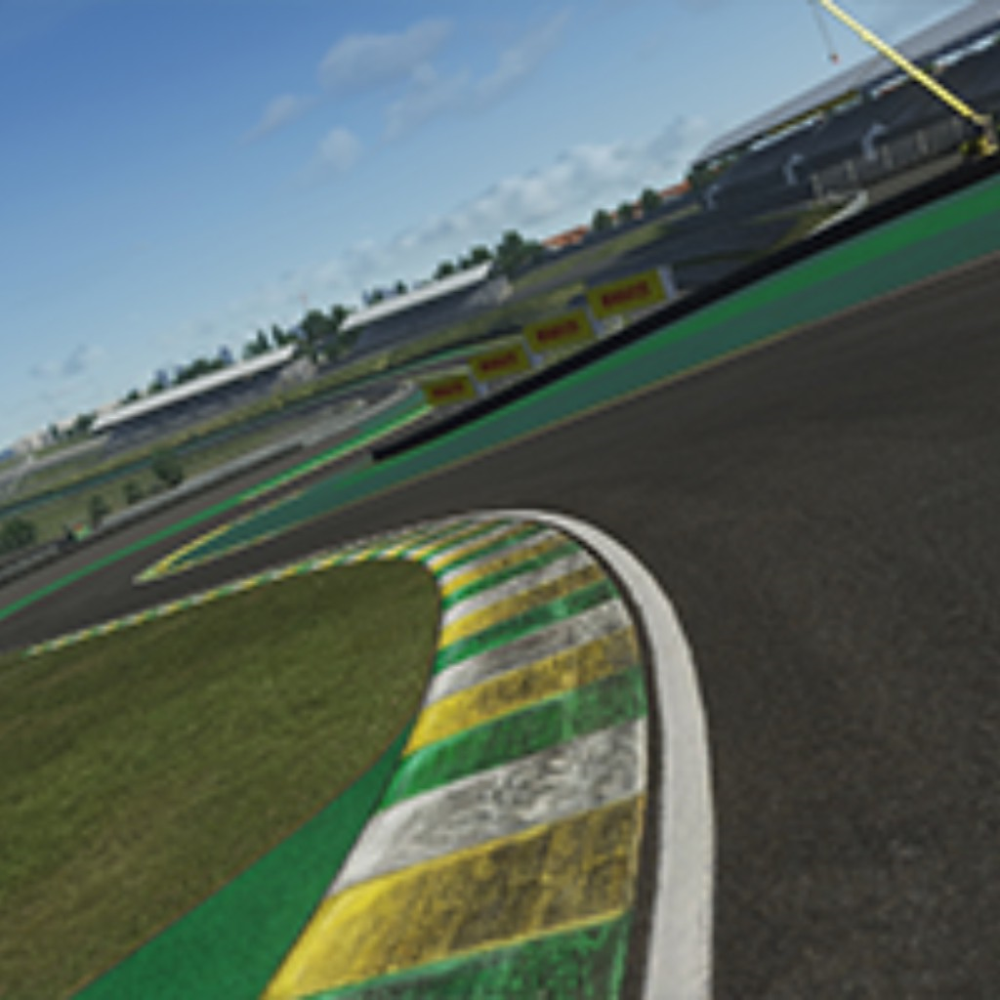

# Autódromo José Carlos Pace (Interlagos - GP) for Live for Speed

Autódromo José Carlos Pace, in Interlagos, São Paulo, Brazil, as an added track for Live for Speed, converted from Assetto
Corsa with lfs-track-builder.

## What you need

- Live for Speed.
- The lfs-custom-track DLL (`dsound.dll` next to `LFS.exe`): the latest from the Discord server

## Versions

- **v1**: first release.

## Credits

- **Track:** VHE Team, All its models and textures are their work.
- **Assetto Corsa:** Kunos Simulazioni.
- **Live for Speed:** Scawen Roberts, Eric Bailey and Victor van Vlaardingen. The world uses LFS's stock material
  table.
- **Conversion:** lfs-track-builder.
